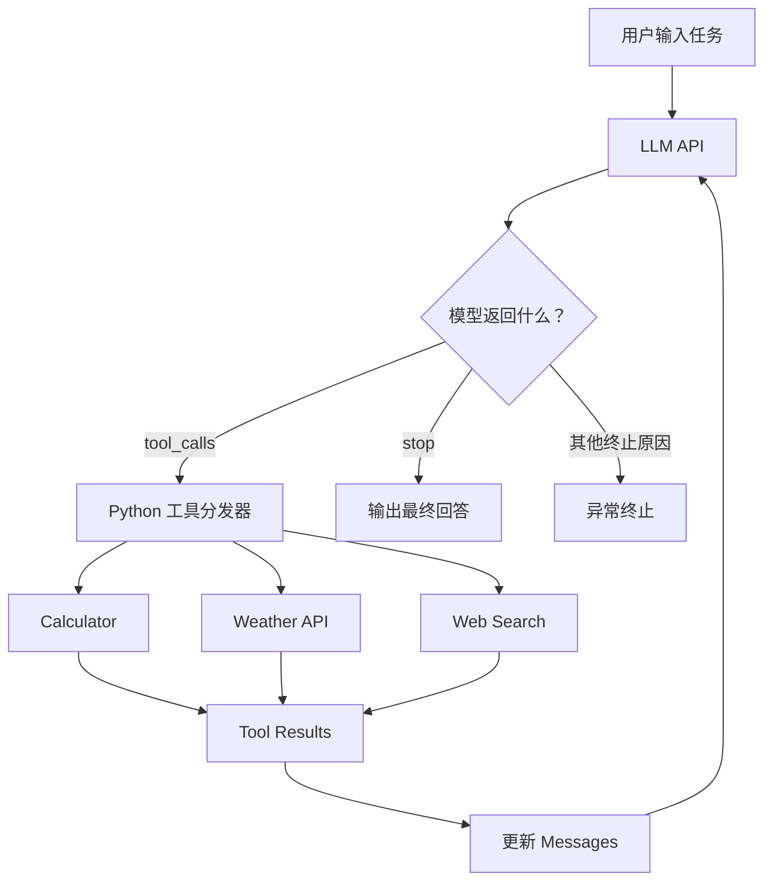

# Minimal Agent Loop

**基于原生 Python 与 LLM Function Calling 实现的轻量级 AI Agent**

本项目是一个不依赖 LangChain、LangGraph 等 Agent 框架的学习型 AI Agent，通过原生 Python 和兼容 OpenAI Chat Completions 的 API，实现一个完整的 **Agent Loop（智能体循环）**。

项目旨在深入理解 Agent 框架的底层工作机制：LLM 如何自主选择工具、生成调用参数，Python 如何执行工具、反馈结果，以及模型如何根据 Observation（观察结果）进行下一轮决策。

## 1. 核心功能

- **原生 Function Calling**：使用 JSON Schema 定义工具接口，直接通过 LLM API 实现工具调用。
- **多工具支持**：集成计算器、实时天气查询和联网搜索三个工具。
- **自主工具选择**：LLM 根据用户任务动态决定调用哪些工具。
- **Agent Loop**：基于 Python `while` 循环，实现多轮决策、工具执行与结果反馈。
- **多工具协作**：支持单轮多个 Tool Calls，以及跨轮依赖前一次工具结果的调用。
- **基础异常处理**：捕获常见参数错误和 HTTP 请求异常，并将错误反馈给 LLM。
- **循环终止控制**：设置最大 LLM 决策轮数，避免无限循环。
- **自动化测试**：通过 pytest 和 Mock 模拟模型响应，无需真实 API 即可验证核心逻辑。

## 2. Agent 工作原理



### 核心执行过程

1. 用户向 Agent 提出任务。
2. Python 将用户消息和可用工具的 JSON Schema 发送给 LLM。
3. LLM 决定直接回答，或者返回结构化的 `tool_calls`。
4. Python 解析 Tool Call，检查工具名称，并调用对应函数。
5. Python 将执行结果以 `role="tool"` 加入消息历史，通过 `tool_call_id` 关联原始调用。
6. Agent 再次请求 LLM，使其根据新增的工具结果继续决策。
7. 模型正常完成回答或程序触发终止条件后，循环结束。

**核心原则：LLM 负责决策，Python 负责执行，Agent Loop 负责连接两者。**

本项目采用 ReAct 风格的迭代式工具调用流程，并通过结构化 Function Calling 实现，不依赖访问模型内部的隐藏推理过程。

## 3. 技术栈

| 技术 | 用途 |
|---|---|
| Python | Agent 主程序与工具执行 |
| OpenAI Python SDK | 调用兼容 Chat Completions 的大模型 API |
| JSON Schema | 定义工具接口与参数结构 |
| Open-Meteo | 天气查询和城市地理编码 |
| DDGS | 联网搜索 |
| Requests | HTTP 请求 |
| pytest | 自动化测试 |
| unittest.mock | 模拟 LLM API 响应 |

模型使用 HKUST GenAI API 提供的兼容接口，当前测试模型为 `gpt-5.6-sol`。

## 4. 项目结构

```text
minimal-agent-loop/
├── main.py                  # Agent Loop、工具定义与分发
├── weather.py               # 实时天气查询工具
├── search.py                # 联网搜索工具
├── tests/
│   ├── test_calculator.py   # 计算器单元测试
│   └── test_agent.py        # Agent Loop 测试
├── requirements.txt         # Python 依赖
├── .env.example             # 环境变量示例
├── .gitignore               # Git 忽略配置
└── README.md                # 项目文档
```

## 5. 安装与运行

### 5.1 克隆项目

```bash
git clone https://github.com/YOUR_USERNAME/minimal-agent-loop.git
cd minimal-agent-loop
```

将 `YOUR_USERNAME` 替换为实际的 GitHub 用户名。

### 5.2 创建虚拟环境

```bash
python3 -m venv .venv
source .venv/bin/activate
```

### 5.3 安装依赖

```bash
pip install -r requirements.txt
```

### 5.4 配置 API

复制环境变量模板：

```bash
cp .env.example .env
```

在 `.env` 中填写自己的 API 配置：

```dotenv
HKUST_API_KEY=your_api_key_here
MODEL=gpt-5.6-sol
```

当前实现使用 HKUST GenAI API，其他用户若使用不同模型服务，需要修改 `main.py` 中的 API Client 配置。

**注意：不要将真实 API Key 上传到 GitHub。**

### 5.5 启动 Agent

```bash
python main.py
```

当前示例任务在 `main()` 函数的 `messages` 中定义，可以自行修改用户问题。

## 6. 多工具协作演示

### 示例任务

> 请完成以下任务：
>
> 1. 使用搜索工具找到 LangGraph 的官方 GitHub 仓库链接。
> 2. 使用天气工具查询香港当前气温。
> 3. 使用计算器计算当前气温的两倍，必须使用天气工具返回的实际温度。
> 4. 最后汇总三个结果。

### 实际运行记录

以下为开发过程中的一次成功执行：

```text
--- Round 1 ---
Finish reason: tool_calls

Tool name: search_web
Tool arguments: {'query': 'LangGraph official GitHub repository'}
Tool: search_web → 搜索结果

Tool name: get_weather
Tool arguments: {'city': 'Hong Kong'}
Tool: get_weather → {'city': 'Hong Kong', 'temperature': 25.4, 'unit': '°C'}

--- Round 2 ---
Finish reason: tool_calls

Tool name: calculator
Tool arguments: {'a': 25.4, 'b': 2, 'operation': 'multiply'}
Tool: calculator → 50.8

--- Round 3 ---
Finish reason: stop
```

最终回答包含：

- LangGraph 官方 GitHub：https://github.com/langchain-ai/langgraph
- 香港当前气温（该次测试）：25.4°C
- 当前气温的两倍：50.8°C

### 关键观察

第一轮，模型同时请求搜索和天气两个工具；第二轮，模型利用天气工具返回的实际数值调用计算器。

这验证了两种 Agent 能力：

1. **同轮多工具调用**：一个模型响应可以包含多个 Tool Calls。
2. **跨轮工具依赖**：模型能够根据此前的 Tool Result 决定下一步操作。

当前 Python 程序顺序执行同一轮中的工具调用，并未实现真正的并发执行。

## 7. 错误处理与循环控制

### 工具错误处理

本项目通过 Python `try...except` 捕获部分常见错误，并将错误作为 Tool Result 返回给 LLM。

例如，在天气 API 返回 HTTP 404 时：

```text
Round 1:
  get_weather("Hong Kong")
  → Tool network error: 404 Not Found

Round 2:
  LLM 根据错误结果生成说明
  → 当前无法获取实时气温，不猜测数据
```

### 最大循环轮数

使用 `max_rounds` 限制 LLM 决策轮数：

```python
run_agent(
    client=client,
    model=model,
    messages=messages,
    max_rounds=5
)
```

当模型持续调用工具、超过最大轮数时，程序将停止执行，避免无限循环。

## 8. 自动化测试

项目使用 pytest 进行基础自动化测试。

运行：

```bash
python -m pytest -v
```

当前已通过 **8 项自动化测试**。

| 测试范围 | 数量 |
|---|---:|
| 计算器基础运算、除零和非法操作 | 6 |
| Agent Function Calling 与工具结果反馈 | 1 |
| Agent 最大循环轮数控制 | 1 |
| **合计** | **8** |

Agent 测试使用 `unittest.mock` 模拟 LLM API 的响应，不需要真实 API Key，也不消耗模型额度。

天气与搜索工具已通过真实 API 手动验证，但尚未加入完整的自动化测试。

## 9. 设计边界与后续改进

本项目主要用于理解 Agent 的底层工作机制，而非直接面向生产环境。

当前仍存在以下限制：

- 尚未进行完整的工具参数 JSON Schema 运行时校验。
- 尚未完善所有第三方工具异常处理。
- LLM API 调用尚未实现统一的重试和超时策略。
- 目前仅限制决策轮数，未限制累计 Token 和调用成本。
- 消息历史仅保存在运行内存中，不支持持久化恢复。
- 尚未实现结构化执行日志和独立任务成功校验。
- 尚未提供 Web UI 或交互式命令行界面。

未来可逐步引入更完善的状态管理、工具注册表、日志系统及自动化评估。

## 10. 项目学习收获

通过从零实现这个 Agent，我重点学习和实践了：

1. Function Calling 的底层通信机制。
2. JSON Schema 与 Python 函数的关系。
3. Tool Call 的参数解析与工具分发。
4. Tool Result 与 `tool_call_id` 的关联。
5. 消息历史在多轮 Agent 决策中的作用。
6. ReAct 风格的迭代决策与工具调用。
7. 工具执行失败后的基础错误反馈。
8. 循环终止条件与最大执行轮数。
9. 使用 Mock 对 Agent 控制流程进行自动化测试。

项目的核心目标是通过手写最小实现，理解 LangChain、LangGraph 等 Agent 框架所封装的基础工具调用与循环机制。

---

**项目定位：学习与实验用途。**